# 👁️ Netraya 💙

A **full-stack Eye Clinic Management System** built with **React.js, Node.js, Express.js, and MySQL**.

Netraya replaces paper registers and verbal queues at an eye clinic with a centralized digital system. Patients register and manage their profiles, doctors work through a daily token queue and view patient information, and staff manage patients and tokens.

---

# 📑 Table of Contents

- [Features](#-features)
- [Tech Stack](#️-tech-stack)
- [Project Structure](#-project-structure)
- [Application Workflow](#-application-workflow)
- [Database Design](#️-database-design)
- [Token Queue](#-token-queue)
- [Screenshots](#-screenshots--ui-previews)
- [Installation & Running Locally](#️-installation--running-locally)
- [Known Limitations](#-known-limitations)
- [Future Improvements](#-future-improvements)
- [Key Learnings](#-key-learnings)
- [Developer](#-developer)

---

# ✨ Features

## 👤 Patient Features

- Patient Registration & Login
- Patient Dashboard
- Manage Patient Profile
- View Eye Clinic Services
- View Doctors and Doctor Profiles
- View Today's Token Status
- Patient Logout

## 👨‍⚕️ Doctor Features

- Secure Doctor Login
- Doctor Dashboard
- View Today's Patient Queue
- View Patient Profile
- Manage Token Status
- View and Update Doctor Profile
- Track Patient Consultation Status

## 👩‍💼 Staff Features

- Secure Staff Login
- Staff Dashboard
- Patient Management
- Patient Search
- Token Management
- View Patient Information

---

# 🛠️ Tech Stack

## Frontend

- React.js (Vite)
- React Router
- Bootstrap 5
- Axios
- JavaScript, CSS

## Backend

- Node.js
- Express.js (REST APIs)
- Sequelize ORM
- JWT Authentication
- bcrypt (password hashing)
- dotenv

## Database

- MySQL

---

# 📂 Project Structure

```text
Netraya
│
├── client
│   └── src
│       ├── components
│       ├── pages
│       ├── layouts
│       └── services
│
├── server
│   ├── config
│   ├── controllers
│   ├── routes
│   ├── middleware
│   ├── models
│   ├── uploads
│   └── server.js
│
├── screenshots
│
├── README.md
└── .gitignore
```

---

# 🔄 Application Workflow

```text
                                 👁️ Netraya
                                     │
             ┌───────────────────────┼───────────────────────┐
             │                       │                       │
             ▼                       ▼                       ▼
        👤 Patient               👨‍⚕️ Doctor               👩‍💼 Staff
             │                       │                       │
             ▼                       ▼                       ▼
      Register / Login          Doctor Login            Staff Login
             │                       │                       │
             ▼                       ▼                       ▼
     Patient Dashboard       Doctor Dashboard        Staff Dashboard
             │                       │                       │
       ┌─────┼─────┐                 ▼                       ▼
       │     │     │            Today's Queue      Patient Management
       ▼     ▼     ▼                 │                       │
   Services Doctors Profile          ▼                       ▼
       │     │     │            Patient Profile        Search Patient
       │     │     │                 │                       │
       └─────┴─────┴─────────────────┴───────────────────────┘
                                     │
                                     ▼
                              🗄️ MySQL Database
```

---

# 🗄️ Database Design

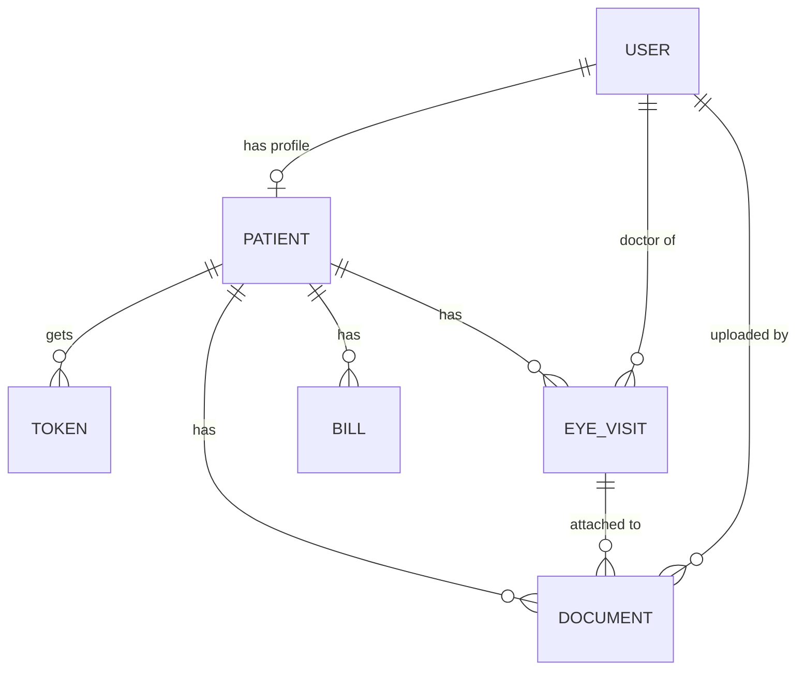

| Model | Key fields | Notes |
|---|---|---|
| **User** | name, phone (unique), password (bcrypt hash), role | Roles: `PATIENT`, `STAFF`, `DOCTOR`, `ADMIN`. Doctor profile fields (qualification, specialization, experience, registration number, languages, department, bio, photo) are stored here and left empty for other roles. |
| **Patient** | dateOfBirth, gender, address, profilePhoto | One-to-one with `User`, which holds the login identity (name, phone, password). |
| **Token** | tokenNumber, tokenDate, status, source | Belongs to a `Patient`. See [Token Queue](#-token-queue). |
| **ClinicSetting** | dailyTokenLimit (default 50) | Clinic-wide setting for the daily token limit. |
| **EyeVisit** | visitDate, visual acuity, sphere / cylinder / axis and IOP for each eye, diagnosis, doctorNotes, followUpDate | Belongs to a `Patient` and a doctor (`User`). |
| **Bill** | billDate, checkupCost, spectaclesCost, spectaclesType, totalCost, paidAmount, dueAmount, status | Belongs to a `Patient`. Status is `DUE` or `COMPLETED`. Amounts are stored as `DECIMAL(10,2)`. |
| **Document** | documentName, documentType, fileName, filePath, uploadedBy, uploadedAt | Belongs to a `Patient`, optionally linked to an `EyeVisit`, and records the uploading `User`. Types: `PRESCRIPTION`, `EYE_REPORT`, `EYE_SCAN`, `SPECTACLE_PRESCRIPTION`, `OTHER`. Files are saved on the server and the path is stored in the database. |

**Delete behavior:** deleting a patient cascades to their tokens, visits, bills and documents. Deleting a doctor or uploader sets those references to `NULL`, so clinical records are kept.

---

# 🎟️ Token Queue

Netraya uses a **token-based queue** rather than time-slot appointments.

- Each token has a `tokenNumber` and a `tokenDate`, so numbering is per day.
- **Status flow:** `WAITING` → `CALLED` → `WITH_DOCTOR` → `COMPLETED`, or `CANCELLED` / `NO_SHOW`.
- **Source:** `WEBSITE`, `PHONE` or `WALK_IN`.
- The daily token limit is stored in `ClinicSetting.dailyTokenLimit` (default `50`).
- Doctors see today's queue and update token status as patients are called and seen.

---

# 📸 Screenshots & UI Previews

## 🏠 Home Page

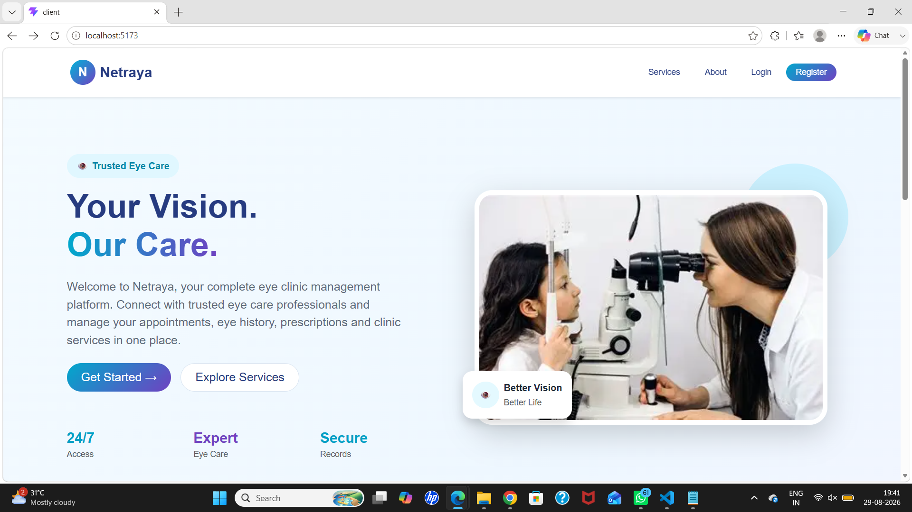

---

## 🔐 Login Page

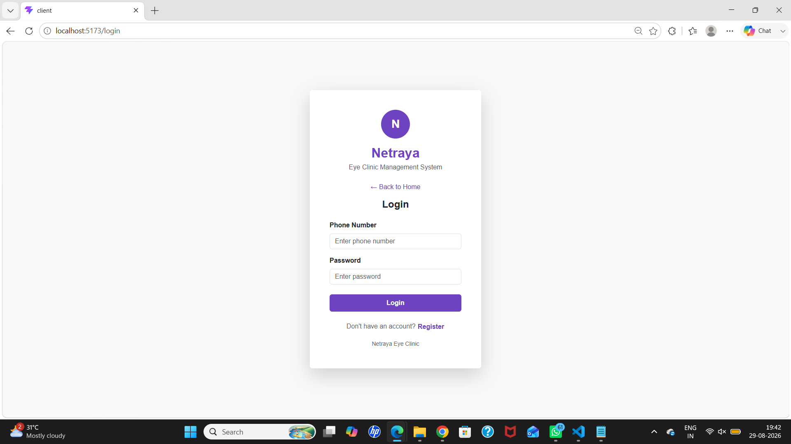

---

## 📝 Registration Page

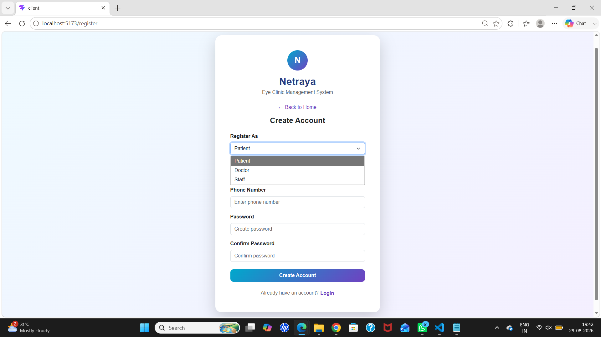

---

## 👤 Patient Dashboard

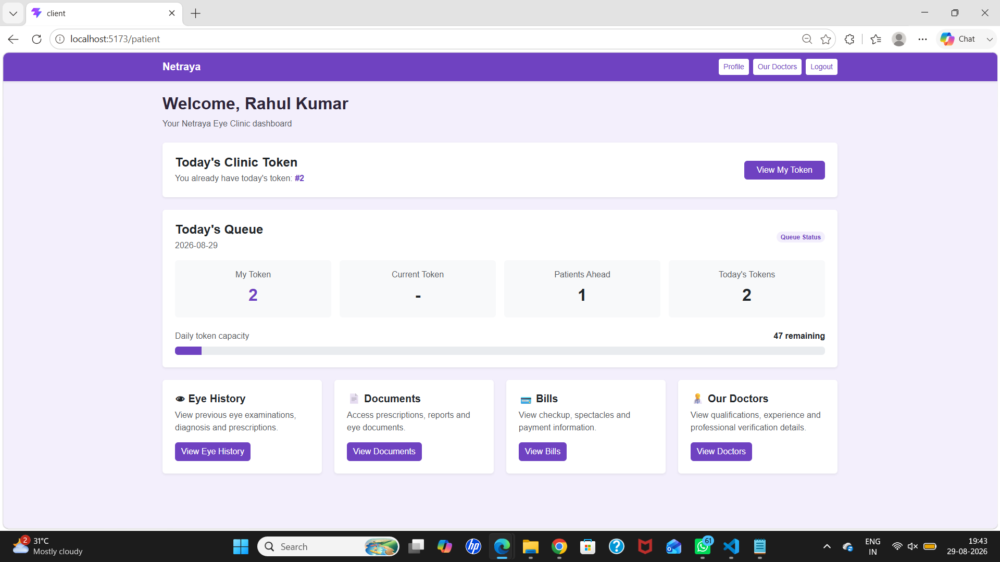

---

## 👨‍⚕️ Doctor Dashboard

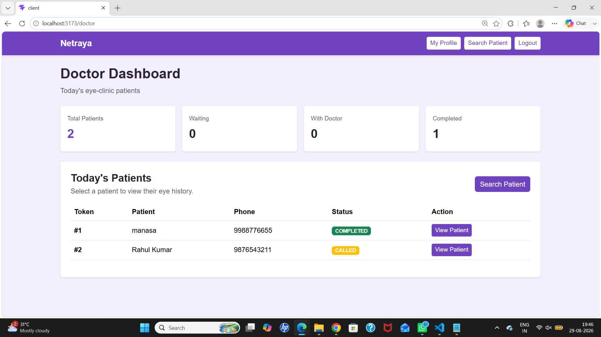

---

## 👨‍⚕️ Doctor Profile

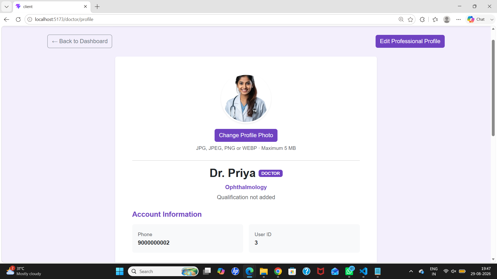

---

## 👩‍💼 Staff Dashboard

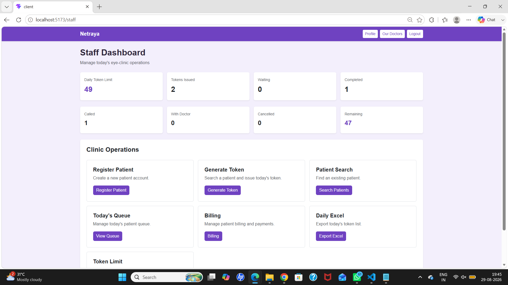

---

## 👨‍⚕️ Our Doctors

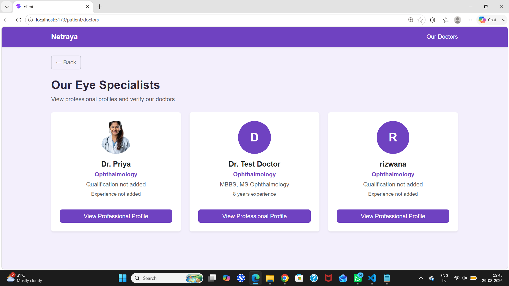

---

## 👁️ Eye Clinic Services

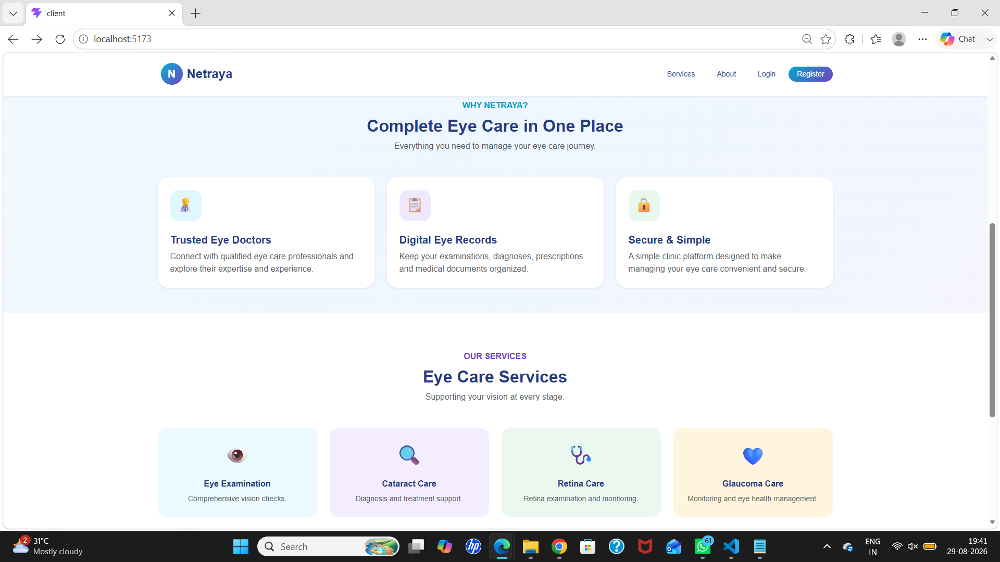

---

## 📋 Today's Patient Queue

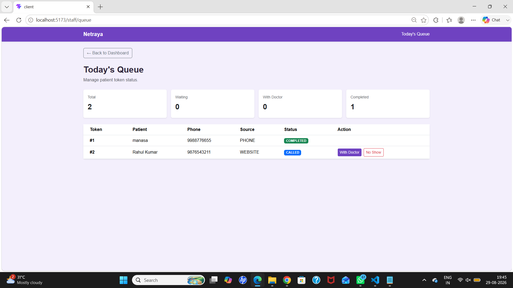

---

## 🔎 Search Patient

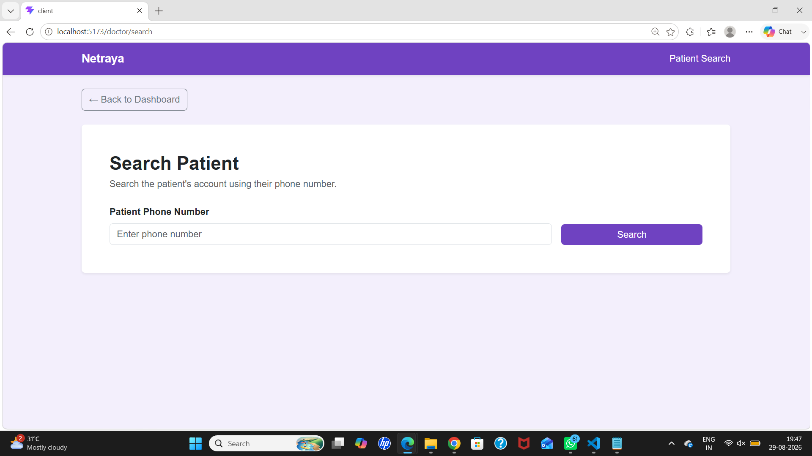

---

# ⚙️ Installation & Running Locally

## 📋 Prerequisites

- Node.js and npm
- MySQL
- Git

## 📥 Clone the Repository

```bash
git clone https://github.com/Rizwana200/Netraya.git
cd Netraya
```

## 🗄️ Database Setup

Create an empty MySQL database for the project (for example `netraya`).

## 🔐 Environment Variables

Create a file named `.env` inside the `server` folder:

```env
PORT=5000
DB_HOST=localhost
DB_USER=your_mysql_username
DB_PASSWORD=your_mysql_password
DB_NAME=netraya
JWT_SECRET=replace_with_a_long_random_string
```

Never commit your `.env` file to GitHub.

## 🖥️ Backend Setup

```bash
cd server
npm install
npm start
```

The backend runs on `http://localhost:5000`.

## 🌐 Frontend Setup

Open a second terminal:

```bash
cd client
npm install
npm run dev
```

The frontend runs on `http://localhost:5173`.

---

# ⚠️ Known Limitations

- The queue is clinic-wide: tokens are not assigned to a specific doctor.
- Eye visits are not linked to the token that produced them.
- Refraction and IOP values are stored as plain text without validation.
- There is no automated test suite yet.

---

# 🚀 Future Improvements

- Online appointment booking with time slots
- Electronic Health Records (EHR) and prescription storage
- Integration with optical store inventory
- Email and SMS notifications for token status
- Doctor analytics and patient visit reports
- Cloud storage for medical scans
- Automated testing framework

---

# 💡 Key Learnings

- Building RESTful APIs with Express.js and Node.js
- React component-based architecture and state management
- Relational modeling in MySQL with Sequelize associations
- Role-based authentication and authorization with JWT
- Designing a token queue for clinic workflows
- Connecting the frontend and backend with Axios

---

# 👩‍💻 Developer

**Rizwana**, B.Tech in Computer Science & Engineering

GitHub: [github.com/Rizwana200](https://github.com/Rizwana200)

---

# 💙 Netraya

**CARE • VISION • PRECISION**

Repository: [github.com/Rizwana200/Netraya](https://github.com/Rizwana200/Netraya)
